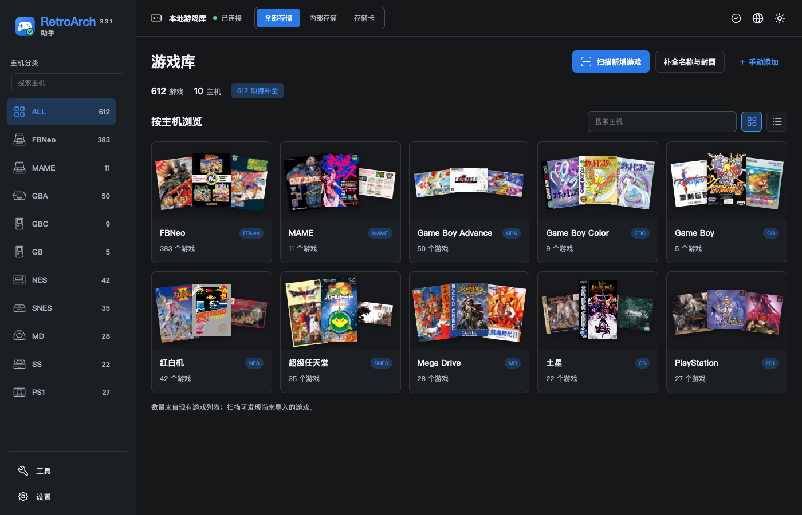

# RetroArch 助手

[English](README_EN.md) · [下载安装包](https://github.com/MightyKartz/retroarch-assistant/releases/latest)

RetroArch 游戏库与掌机管理工具。扫描游戏、整理列表、补全资料，管理你的掌机游戏库。双击启动，在独立应用窗口中管理本地、SD 卡或 USB Android 掌机上的游戏库，无需安装 Python、Node.js 或 Xcode。

## 主要功能

- 按主机浏览游戏，支持封面网格／列表、搜索、存储范围筛选和右侧详情栏。
- 从电脑导入游戏，预览复制内容、重复文件与空间；支持批量移出列表，保留 ROM、封面与存档。
- 增量扫描保留已有名称和核心，排除 BIOS 与内部支持 ROM。
- 补全名称、封面、截图与标题图，展示失败明细并支持重试。
- 提供多盘列表、CHD 转换、ROM 整理与操作恢复。



## 下载与启动

以下为更名后构建的文件名。历史 Release 仍使用 PLCN 前缀，新的更名安装包尚未发布。

请下载 **Release 附件中的安装包**，不要下载 Source code。公开下载无需 GitHub 账号。

| 系统 | 文件 | 启动方式 |
|---|---|---|
| Windows 10/11 x64 | `RetroArchAssistant-Windows-x64-Setup.exe` | 双击安装，从开始菜单打开 |
| Windows 便携版 | `RetroArchAssistant-Windows-x64-Portable.zip` | 完整解压，双击 `RetroArchAssistant.exe` |
| Mac M 系列 | `RetroArchAssistant-macOS-arm64.dmg` | 打开，拖入“应用程序”，启动 RetroArch 助手 |
| Mac Intel | `RetroArchAssistant-macOS-x64.dmg` | 同上 |
| Linux x64（命令行） | `RetroArchAssistant-Linux-x64.tar.gz` | 解压，运行 `./retroarch-assistant --help` |

**当前 GitHub 自动构建的 macOS / Windows 包未做发行证书签名，macOS 未公证。** 首次打开可能被系统拦截；请先核对下载来源，再按 [Apple 官方说明](https://support.apple.com/102445) 或 [Windows 安全说明](https://support.microsoft.com/en-us/windows/security/threat-malware-protection/smart-app-control-frequently-asked-questions)处理。企业策略或 Smart App Control 可能阻止运行，不建议关闭系统防护。

从 v3.2.5 起，Windows / macOS 安装包内置 ADB，无需另装命令行工具。连接 Android 掌机仍需开启 USB 调试，并在掌机上允许此电脑；部分 Windows 设备需要厂商 USB 驱动。本地目录和 SD 卡不需要 ADB。

## 使用

1. 打开已连接掌机、存储卡或本地 RetroArch 游戏库。
2. 点击 **扫描新增游戏**，自动发现支持的主机目录，预览后增量生成游戏列表。
3. 点击 **添加游戏**，在页面内选择电脑来源、目标主机与目录，预览后复制并加入列表。设备上已有文件时，可在此入口指定扫描目录。
4. 点击游戏卡片查看详情、编辑显示名称或更换封面；多选后可只补全所选游戏，或预览后移出列表。名称编辑保留 ROM 文件名和核心，并保留原图片。
5. 点击 **补全名称与封面** 处理整个现有列表。
6. 在“工具”中检查多盘引用、转换 CHD、整理目录或创建 ROM ZIP 副本。写入前退出 RetroArch。
7. 右上角任务图标可查看进度、失败重试、取消与恢复记录；点击设备名称查看详情或切换游戏库，设置中可调整语言与外观。

图片优先搜索 Libretro 官方图库；无结果时可选择备用来源或本地图片。备用图片显示来源和版本提示，预览确认后才写入。

同一光盘的 CUE/BIN 等重复入口会在相应写回操作中清理，ROM 文件不会删除。不同光盘和版本不会仅因中文名相同而删除。修改经过写入校验与读回核对；请在写入前退出 RetroArch，避免它用内存中的旧列表覆盖修改。

配置、缓存及恢复数据保存在本机。图库搜索和图片下载需要联网，不上传 ROM。更多说明见 [使用指南](DOC/DESKTOP_GUIDE.md)。

## 更名与兼容

使用 `retroarch-assistant` 命令与 `RETROARCH_ASSISTANT_HOME` 环境变量，数据和缓存目录名为 `RetroArchAssistant`。升级前退出应用，然后执行一次迁移，保留配置、人工规则和缓存。旧命令、旧环境变量和旧目录不再作为运行入口。详见 [迁移指南](DOC/MIGRATION.md)。

## 开发

```sh
pip install -r requirements-desktop.txt
python3 src/desktop.py
```

```sh
python3 -m pytest -q
python3 scripts/check_ui_js.py
```

桌面包由 GitHub Actions 在对应系统构建并检查。自动检查覆盖资源、内置 ADB、服务启动、实例隔离和安装卸载；不等同于所有系统安全策略或所有 USB 设备均已人工验证。

感谢 [rom-name-cn](https://github.com/yingw/rom-name-cn) 与 [Libretro](https://www.libretro.com/)。ADB 的第三方许可随安装包保留在 `platform-tools/NOTICE.txt`。
