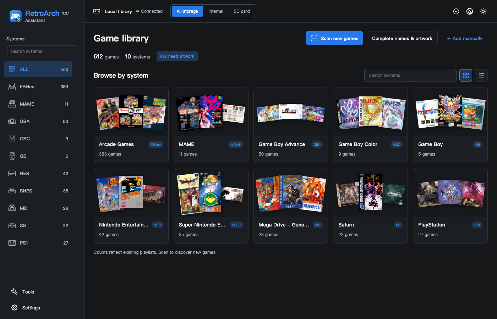

# RetroArch Assistant

[中文](README.md) · [Download](https://github.com/MightyKartz/PLCN/releases/latest)

A RetroArch game library and handheld management assistant. Scan games, organize playlists, and complete names and artwork in a local browser UI. Launch the desktop package with a double click; Python, Node.js and Xcode are not required.

## Features

- System-based game library with real artwork, search and storage filters.
- Incremental scans that preserve existing names and cores and exclude BIOS/support ROMs.
- Name and artwork completion with individual failure details and retry.
- Disc lists, CHD, ROM organization and recoverable operations.



## Install

The table below uses the new build names. Historical releases still use the PLCN prefix; existing installations remain compatible. New branded packages have not yet been published.

Download a **Release asset**, not the Source code archive. Public downloads do not require a GitHub account.

| Platform | Asset | Launch |
|---|---|---|
| Windows 10/11 x64 | `RetroArchAssistant-Windows-x64-Setup.exe` | Install, then open from Start |
| Windows portable | `RetroArchAssistant-Windows-x64-Portable.zip` | Extract everything, open `RetroArchAssistant.exe` |
| Apple Silicon Mac | `RetroArchAssistant-macOS-arm64.dmg` | Drag RetroArch Assistant to Applications, then open |
| Intel Mac | `RetroArchAssistant-macOS-x64.dmg` | Same as above |
| Linux x64 CLI | `RetroArchAssistant-Linux-x64.tar.gz` | Extract, run `./plcn --help` |

GitHub-built Windows/macOS packages currently have no distribution certificate signature; macOS builds are not notarized. System security may block first launch. Consult [Apple](https://support.apple.com/102445) or [Microsoft](https://support.microsoft.com/en-us/windows/security/threat-malware-protection/smart-app-control-frequently-asked-questions). Corporate policies and Smart App Control can prevent execution; disabling protection is not recommended.

Starting with v3.2.5, Windows/macOS packages include ADB. Android USB access still requires USB debugging and authorization on the device; some Windows devices require vendor drivers. Local folders and SD cards do not require ADB.

## Use

1. Open your connected handheld, SD card or local RetroArch library.
2. **Scan new games** to discover supported system folders and review incremental playlist additions.
3. **Complete names & artwork** for existing playlists, or **Add manually** to choose folders and cores yourself.
4. Use Tools for disc inspection, CHD conversion, directory organization and ROM ZIP copies. Review changes before writing and quit RetroArch first.
5. Open the top-right task icon for progress, retry, cancellation and recovery. Click the device name for details; Settings also provides data sources and language/theme preferences.

Artwork searches prioritize Libretro, with alternate-source previews and local import available. Source and edition hints are shown before confirmation. Writes remove matching raw-disc companion entries such as CUE/BIN, without deleting ROM files or merging editions/discs just because their translated labels match.

Settings and recovery data remain local. Artwork searches/downloads use the network; ROMs are not uploaded. See [desktop guide](DOC/DESKTOP_GUIDE.md).

## Compatibility

The display name is now RetroArch Assistant. The repository URL, `plcn` CLI, `PLCN_HOME`, application IDs and existing PLCN data/cache directories remain compatible. Settings, backups, recovery receipts and browser language/theme preferences are reused without migration. Existing RetroArch playlists and ROM paths are unchanged.

## Development

```sh
pip install -r requirements.txt
python3 src/plcn.py
python3 -m pytest -q
python3 scripts/check_ui_js.py
```

CI builds on each target OS and checks bundled resources/ADB, service lifecycle, isolated profiles and installation. These checks do not certify every OS security policy or USB device.

Thanks to [rom-name-cn](https://github.com/yingw/rom-name-cn) and [Libretro](https://www.libretro.com/). ADB notices ship in `platform-tools/NOTICE.txt`.
